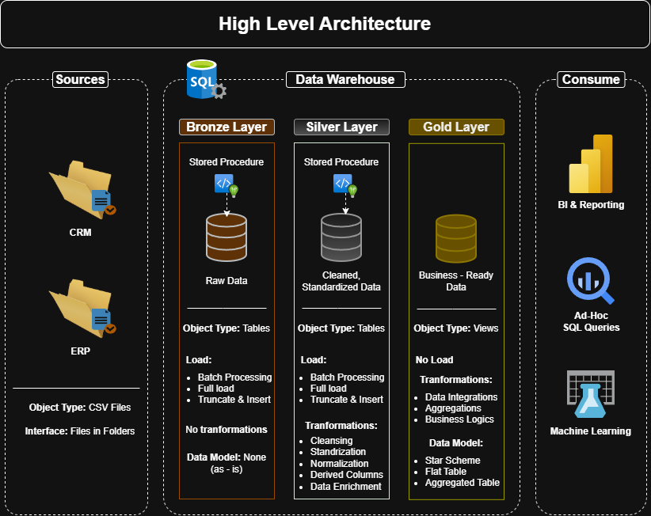

# SQL-Data-Warehouse
# Proyecto de Almacenamiento de Datos y Análisis

¡Bienvenido al repositorio del **Proyecto de Almacenamiento de Datos y Análisis**! 🚀
Este proyecto demuestra una solución integral de almacenamiento de datos y análisis, desde la creación de un almacén de datos hasta la generación de información útil. Diseñado como un proyecto de portafolio, destaca las mejores prácticas de la industria en ingeniería y análisis de datos.

---
## 🏗️ Arquitectura de Datos

La arquitectura de datos para este proyecto sigue las capas **Bronce**, **Plata** y **Oro** de la Arquitectura Medallion:


1. **Capa Bronce**: Almacena los datos sin procesar tal cual provienen de los sistemas de origen. Los datos se ingieren desde archivos CSV a una base de datos SQL Server.

2. **Capa Plata**: Esta capa incluye procesos de limpieza, estandarización y normalización de datos para prepararlos para el análisis.

3. **Capa Oro**: Alberga datos listos para el negocio, modelados en un esquema de estrella, necesarios para la elaboración de informes y análisis.

## 📖 Resumen del proyecto

Este proyecto incluye:

1. **Arquitectura de datos**: Diseño de un almacén de datos moderno utilizando las capas **Bronce**, **Plata** y **Oro** de la arquitectura Medallion.

2. **Pipelines ETL**: Extracción, transformación y carga de datos desde los sistemas de origen al almacén.

3. **Modelado de datos**: Desarrollo de tablas de hechos y dimensiones optimizadas para consultas analíticas.

4. **Análisis e informes**: Creación de informes y paneles basados ​​en SQL para obtener información útil.

🎯 Este repositorio es un excelente recurso para profesionales y estudiantes que buscan demostrar su experiencia en:
- Desarrollo SQL
- Arquitectura de datos
- Ingeniería de datos
- Desarrollo de pipelines ETL
- Modelado de datos
- Análisis de datos

---

## 🛠️ Enlaces y herramientas importantes:

¡Todo es gratis!

- **[Conjuntos de datos](datasets/):** Acceso al conjunto de datos del proyecto (archivos CSV).
- **[SQL Server Express](https://www.microsoft.com/en-us/sql-server/sql-server-downloads):** Servidor ligero para alojar su base de datos SQL.}
- **[SQL Server Management Studio (SSMS)](https://learn.microsoft.com/en-us/sql/ssms/download-sql-server-management-studio-ssms?view=sql-server-ver16):** Interfaz gráfica de usuario para administrar e interactuar con bases de datos.
- **[DrawIO](https://www.drawio.com/):** Diseñe arquitecturas de datos, modelos, flujos y diagramas.
- **[Pasos del proyecto en Notion](https://app.notion.com/p/SQL-Data-Warehouse-Project-d6aabb3d162e83d0819301a0e64cf256?source=copy_link):** Acceso a todas las fases y tareas del proyecto.

---

## 🚀 Requisitos del proyecto

### Creación del almacén de datos (Ingeniería de datos)

#### Objetivo
Desarrollar un almacén de datos moderno utilizando SQL Server para consolidar los datos de ventas, lo que permitirá generar informes analíticos y tomar decisiones informadas.

#### Especificaciones
- **Fuentes de datos**: Importar datos de dos sistemas de origen (ERP y CRM) proporcionados como archivos CSV.

- **Calidad de los datos**: Limpiar y resolver los problemas de calidad de los datos antes del análisis.
- **Integración**: Combine ambas fuentes en un único modelo de datos fácil de usar, diseñado para consultas analíticas.

- **Alcance**: Céntrese únicamente en el conjunto de datos más reciente; no se requiere historización de datos.

- **Documentación**: Proporcione documentación clara del modelo de datos para apoyar tanto a los responsables de negocio como a los equipos de análisis.

---

### **BI: Análisis e Informes (Análisis de Datos)**

#### Objetivo
Desarrollar análisis basados ​​en SQL para proporcionar información detallada sobre:
- **Comportamiento del cliente**
- **Rendimiento del producto**
- **Tendencias de ventas**

Esta información proporciona a las partes interesadas métricas clave para la toma de decisiones estratégicas.

Para más detalles, consulte [docs/requirements.md](docs/requirements.md).

## 📂 Estructura del repositorio
```
sql-data-warehouse-project/
│
├── datasets/                          # Conjuntos de datos sin procesar utilizados para el proyecto
│   ├── source_crm/                    # Archivos CSV del sistema CRM
│   │   ├── cust_info.csv              # Información de clientes
│   │   ├── prd_info.csv               # Información de productos
│   │   └── sales_details.csv          # Detalle de ventas
│   └── source_erp/                    # Archivos CSV del sistema ERP
│       ├── CUST_AZ12.csv              # Datos adicionales de clientes
│       ├── LOC_A101.csv               # Ubicación de clientes
│       └── PX_CAT_G1V2.csv            # Categorías de productos
│
├── docs/                              # Documentación del proyecto y detalles de la arquitectura
│   ├── data_architecture.png          # Diagrama de la arquitectura del proyecto
│   ├── data_catalog.md                # Catálogo de datos de la capa Gold, con descripciones de campos y metadatos
│   ├── data_flow.png                  # Diagrama del flujo (linaje) de datos
│   ├── data_integration.png           # Diagrama de cómo se relacionan las tablas de CRM y ERP
│   ├── data_layers.pdf                # Especificación de las capas Bronze, Silver y Gold
│   ├── data_model.png                 # Modelo de datos (esquema estrella)
│   ├── ETL.png                        # Técnicas y métodos de ETL
│   ├── naming_conventions.md          # Convenciones de nombres para tablas, columnas y procedimientos
│   └── Project_Notes_Sketches.pdf     # Notas y bocetos del proyecto
│
├── scripts/                           # Scripts SQL para ETL y transformaciones
│   ├── init_database.sql              # Crea la base de datos DataWarehouse y los esquemas
│   ├── bronze/                        # Scripts para extraer y cargar datos sin procesar
│   │   ├── ddl_bronze.sql             # Creación de tablas de la capa Bronze
│   │   └── proc_load_bronze.sql       # Procedimiento de carga bronze.load_bronze
│   ├── silver/                        # Scripts para limpiar y transformar datos
│   │   ├── ddl_silver.sql             # Creación de tablas de la capa Silver
│   │   └── proc_load_silver.sql       # Procedimiento de carga silver.load_silver
│   └── gold/                          # Scripts para crear modelos analíticos
│       └── ddl_gold.sql               # Vistas del esquema estrella (dimensiones y hechos)
│
├── tests/                             # Scripts de pruebas de calidad
│   ├── quality_checks_silver.sql      # Validaciones de calidad de la capa Silver
│   └── quality_checks_gold.sql        # Validaciones de integridad de la capa Gold
│
├── README.md                          # Descripción general del proyecto e instrucciones
├── LICENSE                            # Información de licencia del repositorio
├── requirements.md                    # Requerimientos de negocio y técnicos del proyecto
└── requirements.txt                   # Dependencias y requisitos del proyecto
```

---

## 🛡️ Licencia

Este proyecto está bajo la licencia [MIT](LICENSE). Puedes usar, modificar y compartir este proyecto libremente, siempre y cuando se cite la fuente adecuadamente.

